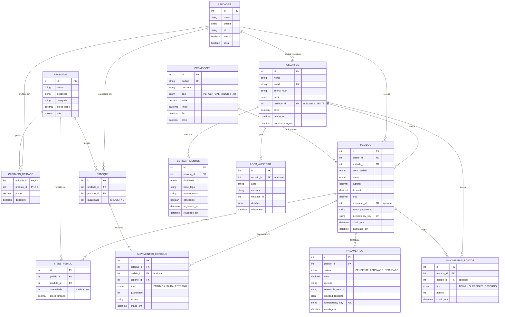

# Diagrama de Entidades e Relacionamentos (DER)

## 1. Modelo Visual (Mermaid)

## 2. Decisões de Modelagem e Justificativas

- **Estoque por Unidade:** Restrição `UNIQUE (unidade_id, produto_id)` com `CHECK (quantidade >= 0)` garante o isolamento do saldo entre filiais e impede que o banco aceite saldo negativo.
- **Cardápio por Unidade:** A tabela relacional `CARDAPIO_UNIDADE` habilita a personalização de preços e a disponibilidade de itens por filial.
- **Pagamento Desacoplado:** Relacionamento $1:N$ entre `PEDIDOS` e `PAGAMENTOS` para registrar histórico de tentativas de pagamento, persistindo a resposta na coluna `payload_resposta` (tipo JSON).
- **Histórico e Rastreabilidade de Estoque:** O saldo atual é mantido em `ESTOQUE`, enquanto alterações de entrada, saída ou estorno são auditadas em `MOVIMENTOS_ESTOQUE`.
- **Snapshot de Preço nos Itens:** A coluna `preco_unitario` em `ITENS_PEDIDO` armazena o preço exato do produto no instante da compra, garantindo a integridade dos relatórios financeiros caso o preço base do produto mude no futuro.
- **Consistência do Saldo de Fidelidade:** O saldo total de pontos de um cliente é calculated via soma dos registros em `MOVIMENTOS_PONTOS` (`ACUMULO` – `RESGATE`), eliminando duplicidade ou divergência de saldos gravados.
- **Tratamento de Idempotência:** Aplicação de restrição `UNIQUE` sobre a coluna `idempotency_key` nas tabelas `PEDIDOS` e `PAGAMENTOS`.
- **Otimização de Desempenho (Horários de Pico):**
  - Índice em `pedidos(unidade_id, canal_pedido, status)`
  - Índice em `pedidos(cliente_id)`
  - Índice em `estoque(unidade_id, produto_id)`
